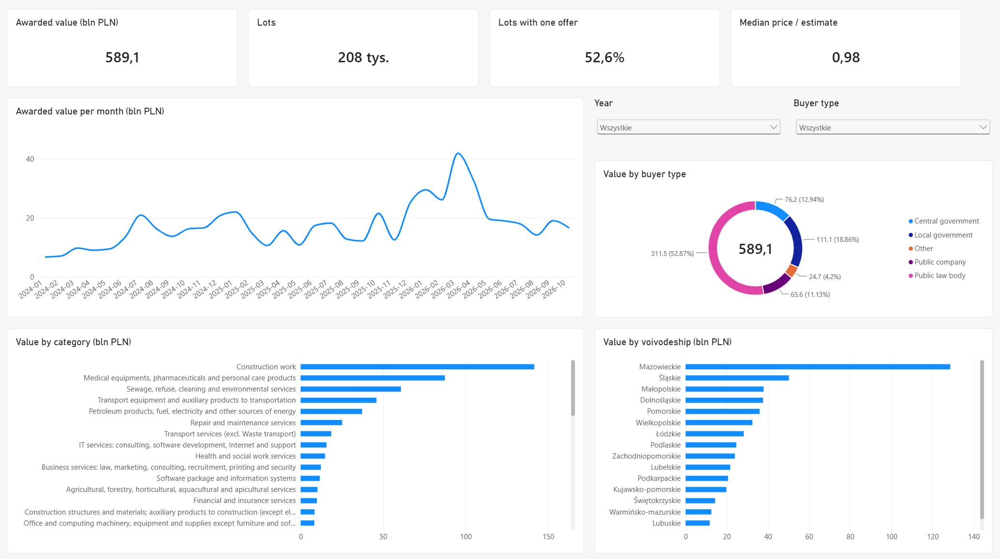
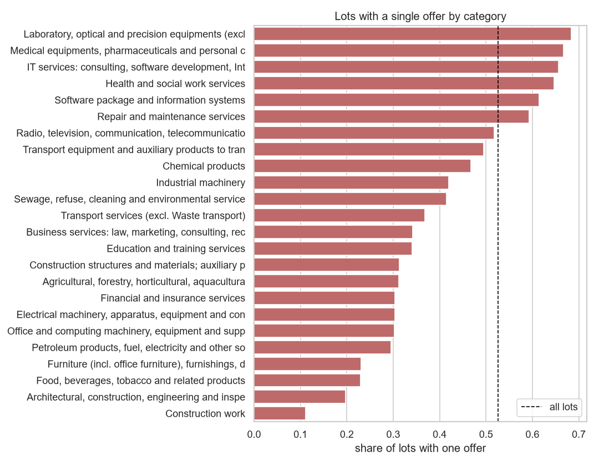
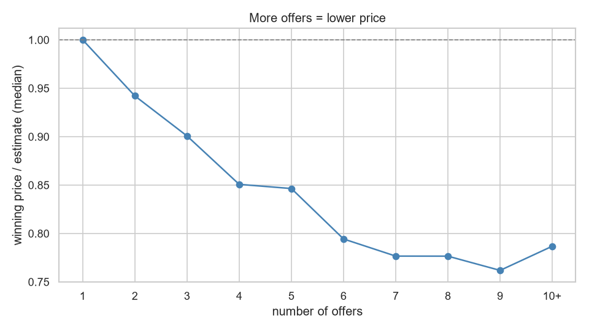

# public-tenders-analysis

Analysis of Polish public tenders from TED (EU tenders database). I checked how many companies take part in tenders, if more offers mean a lower price and which markets could be good for a company that wants to start in public tenders.

Data: 128k contract award notices from Polish buyers from 01.2024 to 10.2026, 208k lots after splitting notices into lots.

Used: Python, DuckDB, SQL, Jupyter, Power BI.



## Files

src/fetch_ted.py downloads notices from TED API, src/fetch_reference.py downloads CPV codes and NBP exchange rates. src/build_db.py with sql/model.sql builds the DuckDB database (fact table and dimensions). src/export_powerbi.py makes csv files for Power BI. The analysis is in notebooks/ (data quality, market overview, competition, price, opportunities) and the report is in powerbi/.

## Data cleaning

The API gives lot data as lists which are not always in the same order, so I split only the notices where it was clear (73%). Some values are typos, for example 9 bln PLN for portable toilets, so I removed values bigger than the whole notice and values over 1 bln PLN without a similar estimate. Offer counts like 0 or 201872 are treated as missing. The same buyer had different ids ("5671783718", "nip: 5671783718", with a tab at the end) so I changed them to the NIP number. Other currencies are converted to PLN with the NBP rate from the publication day.

## Results

Value of contracts:

| year | lots | value [bln PLN] |
|---|---|---|
| 2024 | 57 399 | 159.5 |
| 2025 | 81 010 | 193.4 |
| 2026 (Jan to Oct) | 69 366 | 236.2 |

52.6% of lots got only one offer, median number of offers is 1.

| contract type | lots with one offer |
|---|---|
| supplies | 57.8% |
| services | 43.2% |
| works | 11.1% |



Winning price divided by the buyer's estimate (lots where the estimate was given):

| offers | median price / estimate |
|---|---|
| 1 | 1.00 |
| 2 | 0.94 |
| 3 | 0.90 |
| 4 or 5 | 0.85 |
| 7 or more | ~0.78 |



I also checked it with a regression (controls for category, contract type and year) and 2x more offers gives about 9% lower price.

Markets with high value, many buyers, few offers and no big dominant company:

| CPV group | value [bln PLN] | avg offers | one offer | top winner share |
|---|---|---|---|---|
| Medical equipments | 30.4 | 1.52 | 74% | 4% |
| Refuse and waste services | 24.9 | 1.86 | 56% | 4% |
| Pharmaceutical products | 49.3 | 1.99 | 60% | 12% |
| Software packages | 5.1 | 1.64 | 67% | 11% |
| Software programming and consultancy | 7.8 | 1.61 | 73% | 13% |

## Conclusions

More than half of contracts have only one offer. With one offer the price is the same as the estimate, with 2 offers it is about 6% lower and with 4 or 5 offers about 15% lower. Buyers could save around 3 to 6 bln PLN per year if single offer lots got a second offer (rough estimate). The buyer publishes the budget before opening offers, so a company that is alone has no reason to offer less.

Medical equipment, waste services, drugs and software look like the best markets to start. Only about 5% of buyers give 80% or more of their lots in a market to the same company. Region doesn't change much (46% to 59% one offer), the category matters more.

## How to run

```
pip install -r requirements.txt
python src/fetch_ted.py --start 2024-01 --end 2026-10
python src/fetch_reference.py
python src/build_db.py
python src/export_powerbi.py
```

For Power BI open powerbi/TenderAnalysis.pbip, set the DataFolder parameter to your data/powerbi/ folder and refresh.

## Limitations

TED has only tenders above EU thresholds, smaller ones are not here. 27% of notices with many lots were not split. The estimate is given only for part of the lots.
